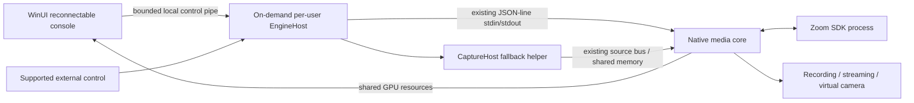

# Engine survival across a UI crash

Owner request: October 19, 2026. Tracking parent: [#959](https://github.com/iamfatness/CoreVideoPro/issues/959).
Baseline inspected: `e377531014e501c6875a2ec471daf5bd54cc6ed1`.
This is an implementation design and acceptance contract, not implemented behavior.
Work order lives only in [BACKLOG](../BACKLOG.md); issue state lives on GitHub.
The owner selected UI-crash survival as the first outcome of this stability plan.
This planning change does not interrupt unrelated Now work or authorize an installed-app rollout.

## Outcome and limits

A terminated, hung or disconnected WinUI console must not end the committed show.
Native core and Zoom process epochs, source assignments, recording sessions, stream
connections and virtual-camera publication survive. A replacement console adopts
live state before accepting edits. Required media continues at the configured quality
and deadlines. UI display itself cannot continue after its process dies; restored
display is tested separately after attachment.

Core/GPU/host failure recovery is a different contract: it may interrupt outputs.
This milestone does not promise survival of Windows logout, machine failure or driver
reset, and does not claim an unlimited hard-real-time guarantee. It preserves existing
core-restart recovery behavior without relabeling recovery as continuity.

## Proposed process ownership

Use a new `native-shell/CoreVideoPro.EngineHost` console executable in the user's
interactive session. It hosts existing managed supervision/control code; native core
keeps pixels/PCM. It launches on demand, not at machine boot, and is distinct from the
optional OHG show engine. Keep native core stdin/stdout, Zoom IPC and GPU/shared-memory
media transport. Only shell-to-host control needs a reconnectable endpoint.

This design avoids rewriting the native RPC runtime solely to change parentage.
EngineHost must continuously drain native responses/logs even with no console attached.
Neither shell disposal nor shell-owned job-object cleanup may terminate EngineHost.

| State or activity | Authoritative owner | Console responsibility |
|---|---|---|
| Applied routes, frames, mixer, output lifecycle/progress | Native core | Observe measured state |
| Committed operator intent and revisions | EngineHost | Submit revision-checked edits |
| Zoom facts and roster epochs | Zoom/native core | Project authoritative facts |
| Periodic spine synchronization and production automation | Focused EngineHost coordinators | Configure/observe |
| Core supervision, bounded rejoin, output resume intent | EngineHost | Show recovery and permit explicit cancellation |
| Native UVC camera | Native core | Select device and observe |
| Compatibility MediaCapture fallback | CaptureHost | Select device and observe |
| Draft edits, selection, navigation, window geometry | WinUI | Own locally; never replay as live truth |
| Show/preferences persistence | Versioned committed-state store using existing secret protection | Explicit save/load actions; no stale startup overwrite |

Inventory all shell timers and callbacks, including MagicScene, source assignment,
audio routing, graphics/clock/automation, HTTP/OSC/Companion and optional OHG paths.
Any enabled behavior that still needs WinUI blocks claiming that configuration as
UI-independent. Do not move entire ViewModels into the host or create a second state bus.

## Attach, commands and shutdown contract

- One EngineHost per user, interactive session and production profile. Serialize
  launch with a named mutex; probe a verified endpoint before spawning. A stale PID
  or discovery file is not authority. Isolated QA profiles need distinct endpoints.
- Use a local-only named pipe with explicit current-user/session access control,
  reject remote clients, and verify server identity. Do not expose a new network
  listener. Validate compatibility using protocol/capability and build identity.
- Reuse `contracts/identity.schema.json` conventions: host epoch, core epoch, client
  ID, show revision and source incarnation. Host epoch and core epoch are distinct.
- Exactly one mutating controller lease with a fencing token. Read-only observers
  may attach. A disconnected or expired lease does not stop the show. A hung old
  client cannot write after replacement; takeover is explicit and observable.
- Attach returns a coherent snapshot/revision. Subscribe with revision reconciliation
  or bounded replay; if history is unavailable request a new snapshot. Enable edits
  only after hydration. Never blindly resend startup preferences or whole saved state.
- Mutations carry command ID, expected revision and fencing token. Cache results with
  bounded retention. A lost ACK is queried/reconciled; unknown outcomes are reported,
  never retried blindly for Take/Record/Stop. Native applied-result evidence determines
  completion; transport acceptance alone does not prove output started.
- Bound clients, input bytes, pending requests and outgoing observation queues. Coalesce
  replaceable snapshots; preserve lifecycle results. A slow client disconnects or
  resynchronizes without backpressuring core pipes or media. Retain reserved stop capacity.
- Client detach/EOF is not engine stop. Closing a console offers a clear continue-show
  versus stop-show action when production is active. Explicit Stop cancels recovery
  intent, drains/finalizes outputs and retires children with bounded failure reporting.
- Idle exit is allowed only when there is no meeting/capture, production, automation
  or pending finalization. Initial implementation may use explicit host exit instead
  of introducing an idle timer. Host/machine restart must not silently resume publishing.
- Session-memory credentials live outside WinUI; never serialize secrets into attach
  snapshots/logs. Persistent credentials retain existing protected storage. This is
  not a new plaintext show journal.

## Implementation boundaries and dependency gates

The following are code boundaries, not a second ranked work queue. Scheduling and
maximum three active development items remain governed by BACKLOG.

| Issue | Dependency | Concrete change and completion evidence |
|---|---|---|
| [#960](https://github.com/iamfatness/CoreVideoPro/issues/960) | None within this initiative | EngineHost, bounded transport, launch/attach/fencing and real opt-in WinUI consumer. Synthetic native show, local stream and recording survive UI kill with unchanged epochs/session IDs. No framework-only landing. |
| [#961](https://github.com/iamfatness/CoreVideoPro/issues/961) | #960 | Move shell-owned spine sync, committed intent, supported control ingress, production automation and recovery into focused host coordinators. Guest churn, lost ACK and reattach assert actual applied state while UI is absent. |
| [#962](https://github.com/iamfatness/CoreVideoPro/issues/962) | #960 and #961 | Move WinRT compatibility capture into CaptureHost, preserve unified source identity and exclusive device ownership. Force native-open failure and verify real fallback media across UI kill/reconnect. |
| [#963](https://github.com/iamfatness/CoreVideoPro/issues/963) | #960–#962 | Package matched host/client/core, add crash drill, validate upgrade/rollback/stop, and run full output qualification. Default enablement waits for this gate. |

Likely code touchpoints:

- New EngineHost project, host session coordinator, pipe client/server and shell attach
  bootstrap behind `IMediaCoreBridge`; reuse `MediaCoreSupervisor` rather than duplicate it.
- `MediaCoreBridgeService`, `MediaCoreSyncScheduler`, spine payload building, recovery
  trackers and `OutputResumeAfterCoreRestart`; extract UI-dependent factories and callbacks.
- Focused MagicScene/Transport/ShowInputs consumers and external-control adapters.
  Do not add orchestration to `StudioViewModel.cs` or `MediaCore.cpp`.
- `NativeUvcCapturePolicy`, `CaptureDeviceFrameReaderService`, shared-memory writer
  and unified source registration for CaptureHost migration. Native UVC stays preferred.
- Existing launch/package scripts, supervisor/protocol tests and `scripts/qa` crash drills.
  Keep legacy stdio fixtures working; Windows-only rollout must be explicit for macOS.

Every code PR names one child issue and includes its real consumer and relevant tests.
#960 can merge behind opt-in without claiming #959 complete. No release/default switch
occurs until production state, fallback capture and packaged evidence are all qualified.

## Acceptance matrix

| Fault or transition | Required result |
|---|---|
| Kill WinUI or terminate client pipe | Host/core/Zoom and output sessions unchanged; receivers continue |
| Suspend WinUI for 10 seconds / block its reader | Bounded client memory; media and external controls remain responsive |
| Reopen with stale saved profile | Hydrate current show; no route rollback, rejoin or output restart |
| Two clients / old client wakes after takeover | One fenced writer; stale mutations rejected |
| Lost ACK / reconnect / expired dedup history | Actual outcome reconciled or explicitly unknown; no duplicate action |
| Guest leave/rejoin/reused SDK ID while UI absent | Correct live audio/source topology; no wrong-guest retained pixels |
| Native-open failure using compatibility capture | Real fallback pixels/PCM survive UI death; identity remains stable |
| Capture helper dies / device unplugged | Explicit local fallback/recovery; distinguish from UI-only continuity |
| Core dies while UI absent | Existing bounded rejoin/output-resume semantics preserved; gap reported |
| Explicit Stop, shutdown or incompatible update | No surprise restart; bounded finalization and truthful failure reporting |

Proposed minimum packaged evidence: a clean baseline plus 30-minute stressed runs for
each supported 2- and 3-frame Program-buffer configuration, including at least ten
UI kill/reconnect cycles, five 10-second suspensions and a five-minute absent-client
interval. Record fault times. These counts are minimum coverage, not proof of unlimited
reliability. Run longer/multi-hardware qualification under #930/#517 as required.

Workload: eight remote 1080p Zoom feeds, webcam, screen capture, attached Preview and
multiview, Program plus eight ISO recordings, independent Windows virtual-camera
receiver and selected RTMP/SRT local test receiver. Test native and actual compatibility
camera paths. Use source pixel identity and audio markers; preserve 1080p60, quality
and the approved buffer. Keep startup/preexisting losses separate but visible.

Collect build hashes, hardware/drivers, source readiness, epochs, recording session
IDs, stream reconnect counts, queue/memory high-water, output identities/deadlines,
decoded A/V and playable finalized files. Receiver evidence must span the actual fault
interval. Zero attributable output misses/duplicates/reordering or audio discontinuities
is the UI-crash acceptance requirement. Missing receivers/hardware are MISSING_EVIDENCE,
not a pass; counters alone do not prove delivery. Verify display after reconnection.

Use isolated owned candidates and test destinations; preserve the installed app and
production preferences. Do not publish to saved real destinations as part of the drill.

## Packaging and rollout

Stage version-matched host/client/core payloads together. A reconnecting console must
find the running generation, not start a second host with the new package. Retain in-use
executables during upgrade and refuse incompatible attachment with a clear action.
No updater may kill active production or re-register its camera behind the operator.
Explicit stop is required before retiring a live generation or rolling back packages.
Uninstall reports active production and requires explicit stop or abort; it must not
leave an unmanaged engine or silently terminate outputs. Document logout/shutdown limits.

## Relationship to existing architecture work

Live GitHub state checked October 19, 2026; this table is a relationship snapshot, not
status authority or an instruction to close/reopen another issue.

| Existing issue | Relationship |
|---|---|
| #930 (open) | Full-workload UI/media independence acceptance; #959 adds process-lifetime survival rather than replacing its existing failing evidence. |
| #657 (open) | Reuse state-authority/identity contract in #961. Its original prohibition on a new always-running process remains: this host is on-demand and scoped to #959. Do not claim all cross-platform state work complete. |
| #517 / #904 (open) | Per-output delivery and monitor admission acceptance; receiver evidence stays independently gated. |
| #908 (open) | Preserve source generation/identity during autonomous guest churn and fallback migration. |
| #857 (open) | Camera registration/ownership acceptance remains separate; moving fallback does not fix it automatically. |
| #873 / #870 / #947 (closed) | Preserve bounded resource events, off-lock snapshot construction and deadline-worker scheduling as implemented groundwork. Do not reopen them because older backlog prose is stale. |
| #732 (closed) | Preserve core-restart recording/stream recovery while relocating its owner; UI-only failure must not trigger it. |
| #513 (open, owner-deferred) | UI crash investigation remains separate; crash containment reduces its show impact without asserting its cause fixed. |

After UI-crash survival, frame-boundary prepared configuration and remaining lock/resource
admission work should extend #517/#930 and #657 contracts, with concrete consumers and
new scoped issues only when the remaining gap is established. GPU-loss coordination and
standby output are separate fault domains, outside #959 closure. They are not silently
promoted to Now by this plan.
