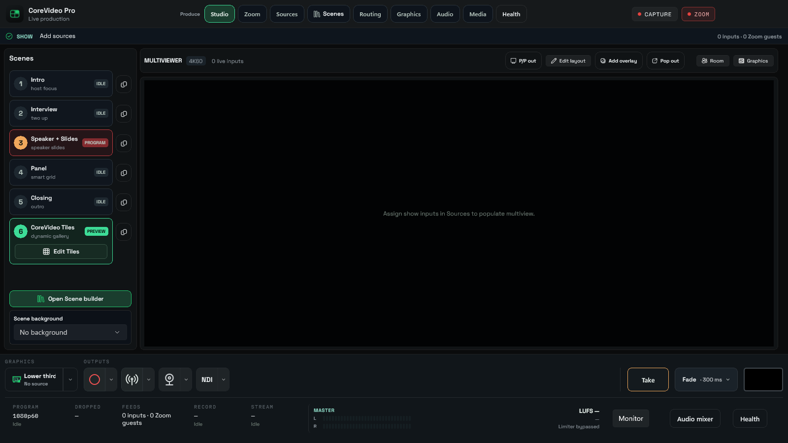
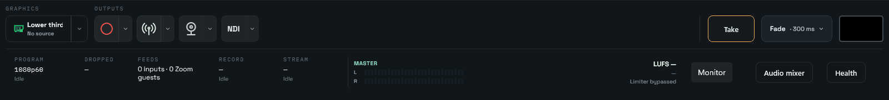

# First-release scene control

Owner decision, November 9, 2026: exclude Set & Forget and the legacy Magic Scene
workflow from the first release. CoreVideo Tiles owns composition. Scene selection
and Take remain manual through Studio, keyboard, and Stream Deck/Companion.
This supersedes the automation promises in the earlier product and director specs;
it does not change the Tiles speaker-follow or membership policies.

Windows removes the legacy footer buttons and Automation navigation. A restored
legacy page provides manual-production guidance and the separate free-input filling
setting. The production MagicSceneCoordinator constructor cannot enable scene
automation: commands, direct mode assignments and automatic-Take intent are blocked,
and snapshot/timer evaluation cannot bind Preview, start the timer, change graphics,
or Take. The internal opt-in constructor is solely for deferred-engine unit tests;
there is no user setting, environment variable or license override.

The remote action catalog no longer advertises automation.magic, automation.toggle
or automation.autoTake.set. Saved HTTP/OSC/Companion commands fail validation instead
of silently re-enabling the feature. The adapter also rejects those legacy IDs if
called directly. Existing clients should remove those buttons. Manual transport.take,
scene controls and Tiles controls remain registered. The outputs drill no longer
sends the retired auto-Take command.

macOS removes the same controls and navigation. Its immutable release gate prevents
setAutoDirect from starting a timer; the evaluator and one-shot command are guarded.
Legacy auto-Take preferences are ignored. Native macOS build/runtime verification
requires macOS and is not covered by Windows checks.

Automatic filling of free input slots and the separate native graphics automation
are not the retired scene director and remain available. No installer or saved user
profile is modified by this source change.

## Studio manual controls

The Windows Studio footer groups Graphics and Outputs on the left, Take/FTB on the right, above a separate
health/audio row. Output option flyouts remain available. Edit Tiles on a Tiles
scene cues that scene to Preview and opens its wall inspector; it never Takes.

Spacebar invokes the existing Take command in Studio; Ctrl+Enter remains an alternate.
Ctrl+Shift+B invokes FTB. These shortcuts ignore text-entry controls. Existing graphics F-key mappings and
remote `transport.take` remain unchanged. Companion discovers `transport.ftb.toggle`
and `transport.ftb.set(enabled)` from the action manifest; its FTB preset lights
from `programBlackout` feedback. Use the idempotent set action when retrying requests.

FTB fades Program video over 300 ms; pressing again restores the picture from the
current fade level. The core appends a neutral black GPU layer above scene and
global graphics. Preview, source ISOs, audio, and running output sessions are
unchanged. Taking another scene while black does not release the blackout. The
RC button has a black fill with no visible text and a red outline when black is selected. No saved
preference automatically engages FTB; a new media-core session starts clear.
Older cores without the blackout observation reject FTB rather than implying success.

Layout checks run in an isolated offscreen window. GPU pixel tests prove the native
compositor fade and restoration; these checks are not a live multi-output soak.

The layout fidelity correction keeps Edit Tiles inside its scene card, separates
Take from the transition selector, arranges Graphics / Outputs / transport as three
measured groups, and gives telemetry its own full-width row. Zoom and Health are
direct top navigation actions. The graphics panel starts closed and the on-air/cued
strip appears with that panel; the Graphics button and function keys remain available.
Scene removal remains in the scene context menu. Background import is available in
the background picker context menu and the scene editor. Layout review builds are
separate from the running application so reviewing them does not restart a meeting.

The footer keeps the lower-third shortcut but omits the generic Preview graphic /
Show on Program buttons. Show, Cue and Hide remain attached to each graphic in
the Graphics workspace; graphics keyboard and remote actions are unchanged.

RC footer outputs use compact Record, broadcast, webcam icons and an NDI badge.
Separate option arrows preserve output settings; tooltips and accessible names
identify each action. Take, transition choice, and the black FTB key are anchored
to the far right. Keyboard and remote commands remain unchanged. Manual blend
is excluded from the RC.

Graphics and output shortcuts form a left-aligned group with a fixed gap; only
the space before Take grows with the window. Output icons use matching 26px
line artwork and neutral idle backgrounds, with record/stream colors reserved
for their active states.

## Compiled Windows layout

These captures come from the isolated compiled layout check, with no live video.

