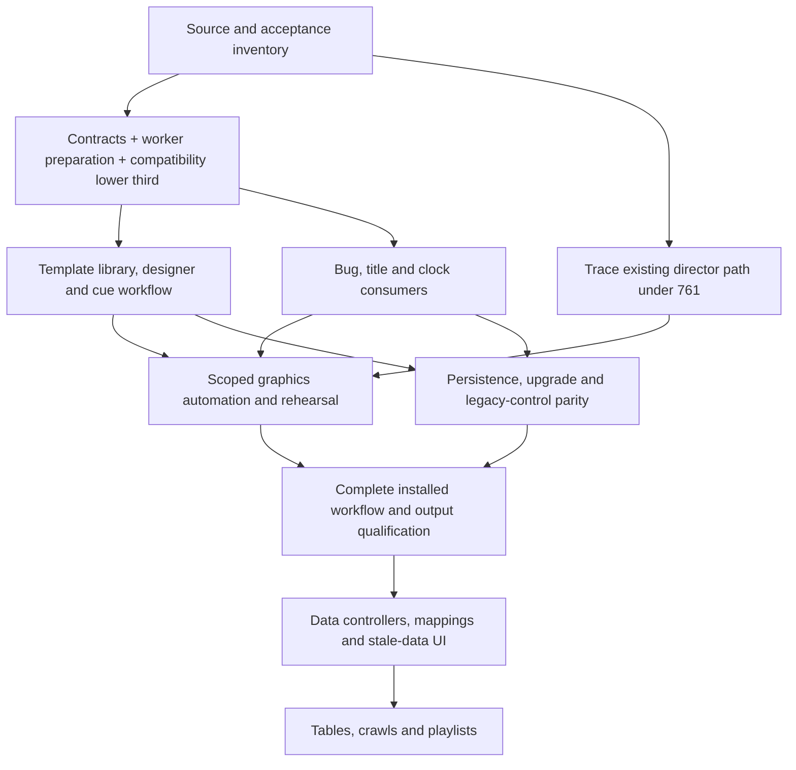

# Volt Graphics implementation plan

Proposed technical sequence for [#924](https://github.com/iamfatness/CoreVideoPro/issues/924),
October 16, 2026. Companion documents:
[specification](volt-graphics-spec.md) and
[reconciliation](volt-graphics-reconciliation.md).

This is a dependency/review plan, not a second ranked backlog or authorization
to implement. `../BACKLOG.md` alone selects work. The current request authorizes
the documents and their review PR. After owner review, record approved scope and
rank before opening implementation. Maximum three active implementation issues;
each PR has one primary issue. A reusable foundation merges only with its first
working consumer and measurable native output.

## 1. Delivery structure

The first product milestone is **a complete branded interview/webinar graphics
workflow**, with lower thirds, titles, logo bugs, clock/countdown, templates/styles
and controlled participant automation. The later data milestone adds connectors,
tables/crawls and playlist execution. These are product gates, not promised weeks.

Existing issue ownership is retained: #847 appearance and designer; #592 stable
text/animation; #593 source-text identity and persistence; #764 field-consumer
audit; #761 director observation/execution; #848 adjustment interactions. New
generic template/instance, worker, bug/clock, graphics-automation and data-controller
scopes are proposed under #924 for review. Once approved, create focused child
issues with their own done-when and backlog rows before development. Do not hide
new implementation inside the documentation issue or silently expand #847 into
all later data/sports functionality.

### Dependency graph

The arrows are implementation dependencies, not permission to run all lanes or
spawn agents. Resource limits and preservation tests apply from the first slice.

## 2. Work packages and review gates

| Package | Concrete implementation boundary | Required result before dependent work |
|---|---|---|
| A. Inventory and qualification baseline | Trace #847/#592/#593/#764/#761 from controls/commands through native state to pixels. Inventory templates, saved presets, default/blank behavior, timing, legacy API and TS inputs. Capture a versioned compatibility fixture set. | A field-to-consumer/evidence matrix naming supported, implemented-but-unverified, absent and incompatible behavior. A missing installed result stays missing; an old issue description is not a current root cause. |
| B. First native vertical slice | Add the graphics contract slice, bounded template loader, instance/revision owner and worker preparation seam through one existing compact-solid lower third. Include source identity, draft/cue/Program separation, native snapshots and a real shell control consumer. | The existing look appears correctly on native Preview/Program; same values are no-ops; actual changed text prepares off the deadline and swaps atomically. No skeleton-only library or contract-only PR. |
| C. Compatibility and operator workflow | Map all three old looks; integrate the existing designer with the library, style presets, canvas/layer inspector, Cue/Show/Hide/Update/Clear, compare, undo and warnings. Persist exact template versions. | Owner can complete the lower-third workflow end to end. A comparison inventory proves no accepted control/text/override was removed. Saved old looks render equivalently or report an explicit approved difference. |
| D. Additional real consumers | Title, transparent logo bug, clock/countdown; shared scope/order rules; eight curated looks. Use the same layout, preparation, lifecycle and API as lower thirds. | Branded lower third + bug + clock operate simultaneously; global/scene scope and countdown pause/reset/restore are correct. Catalog examples are actual native renders. |
| E. Existing automation trace | Under #761, trace recommendation generation -> wire/mapper -> source/slot bindings -> accepted Preview -> optional Take. Fix only reproduced missing seams; preserve the existing native director and its deterministic tests. | Evidence distinguishes recommendation, bound cue and executed native change. No success label when a recommendation cannot act. This is a gate for using its events, not a mandate to rewrite the director. |
| F. Graphics automation | Add rule/preset documents, Manual/Suggest/Rehearsal/Automatic modes, dwell/cooldown, native arbitration, clear/manual-hold inhibition and bounded decision history. Existing show-engine inputs use the same adapter/instance IDs. | A simulated and real subject change reveals once; repeated metadata does not. Manual Hide/Clear wins, pending actions cancel correctly, and reconnect cannot replay a Take/Show. Scene auto-take stays separately armed. |
| G. Migration and persistence completion | Atomic separate graphics documents, source overrides, brand/template pins, legacy control adapter, old/new authority choice, read-only downgrade handling and backup recovery. | Fresh, upgraded and restored shows preserve unrelated settings. No duplicate legacy/new overlays; missing assets remain repairable; restore is hidden/unarmed and opens no network controller. |
| H. Complete-feature acceptance | Integrate accepted issue branches on a review candidate, run actual multi-output pixel/identity and deadline tests, then owner workflow review and sustained bake. | All required rows below have current-build evidence. Package/installer/camera/shortcut validation precedes requesting the owner's installed review. A rendered web page alone is not completion. |
| I. Data controllers | Bounded native JSON HTTP, local CSV/XLSX, RSS and clock adapters; mapping/validation; credential references, health/stale-data UI and manual override. | Measured fetch/change -> adoption latency, no animation on unchanged values, bounded failure/reconnect behavior. One connector and its rendered consumer ship together. |
| J. Data graphics | Keyed table/leaderboard layouts and transitions, cached-segment crawl, deterministic playlist execution. | Real local data updates reach native output with stable row identity, bounded resources and manual transport override. No parser-only/controller-only completion claim. |

Packages C/D can be developed independently only after B's contract/ownership gate.
E can be investigated without waiting for the new graphics owner. H is the first
milestone's release gate. I/J are later work requiring their own owner ranking;
they are not allowed to delay a complete first milestone by remaining half-built
inside its UI. Unsupported controls are absent/disabled with a named reason.

## 3. Code seams and PR boundaries

| Existing seam | Proposed work | Guardrail |
|---|---|---|
| `native/src/compositor/CompositorOverlayRaster.{h,cpp}` | Extract reusable shaping/layout/raster preparation behind a resource owner, retaining current pixel semantics | The current renderer calls it synchronously; moving a wrapper without moving cache-miss work is not sufficient |
| `native/src/compositor/MetalCompositorAdapter.mm` | Reuse the actual Core Text/ImageIO implementation through the same preparation contract | Do not treat its stale header comment as evidence that Core Text is absent; no Windows-only acceptance claim |
| `native/src/modules/OverlayTileRaster.{h,cpp}` and compositor geometry | Common geometry/alpha/compatibility fixtures; deterministic headless checks | Portable glyph fixtures are not accepted as real native typography |
| `native/src/core/MediaCore.cpp` | Small typed command/plan/snapshot adapters into focused graphics components, preferably under `native/src/graphics/` | No new long-lived template/parser/controller logic in the core's god file; snapshot assembly reads published state |
| Existing native command dispatcher/builders | Add revision/epoch/idempotency/result mapping and capability advertisement | Dotted control-action names do not imply native wire support; test raw serialization and decoding, not only property strings |
| `contracts/` generator and fixtures | Add graphics schema/types/validators for current supported native/shell consumers | Preserve additive existing contracts and exact enum/revision validation; do not introduce unused generated clients |
| WinUI `OverlaysViewModel`, designer and Graphics page | Focused library/editor/cue/runtime view models and native texture preview | Keep source text in Sources, use shared adjustments, avoid new behavior in `StudioViewModel.cs` |
| Existing `GraphicsOverlaySync` | Keep caption transcript ownership separate; add an explicit graphics adapter only if needed | Its name is not proof that it already manages template instances |
| `show-engine/src/overlayDirector.ts` | Preserve pure derivation/change detection and translate accepted intent | Never let TS and C++ both own animation or automatically reveal the same instance |
| `ViewModels/MagicScene/MagicSceneCoordinator.cs`, native `Director.h` | Prove the #761 observation/binding/execution path and publish qualified events | Never infer successful Takes from recommendations or mapped UI intent |
| Existing JSON/secret stores and show serializer | Versioned graphics documents, atomic writes, migration and protected credential references | Do not reopen/overwrite the production preferences file to work around an absent API |

A possible B PR contains the minimum package/contract/resource owner plus the
actual compatibility lower-third renderer, shell/API cue consumer and tests. If
too large to review, split by completed behavior (for example, off-deadline
preparation of the existing look first), never by an unused abstraction alone.
Contract additions can stack with the first consumer but must merge together.
Subsequent PRs preserve a runnable feature at each merge.

## 4. Baseline and regression preservation matrix

Capture fixture documents and native output references before changing each path.
Where the current code is already incorrect, keep the failing evidence and the
owner-approved desired result instead of blessing it as a golden image.

| Existing behavior | Required preservation evidence |
|---|---|
| Source primary name, default title, explicit empty and reset | Same source identity and exact blank/default behavior through new template bindings; no lowercase/fragment regression (#592/#593) |
| Compact-solid/minimal-accent/broadcast and saved custom appearances | Pixel/geometry/style equivalence or a separately reviewed visual change; no reset to generic defaults (#847) |
| Existing logo and color/font overrides | Content provenance, missing-font/asset warnings, aspect ratio, alpha and real pixel consumer (#764) |
| Draft compare, Apply/Cancel, saved preset/duplicate | Preview changes privately; explicit Apply/Update changes complete on-air revision once; preset save has no Program effect |
| Scene Builder/Tiles layering and Take | Shared ordering/safe region and scene/global scope are deterministic; source selection, framing, opacity and grades keep their native effect |
| Source grades and scope ROI | No graphics change to grade state or scope masks; editor/ROI guides never enter outputs |
| Keyboard/API/OSC and optional show-engine controls | Same semantic action -> same instance; no double trigger or bypass of manual priority |
| Webcam-only framer/LUFS and source ISOs | Existing output-specific behavior survives; global Graphics controls cannot accidentally burn guides into clean/source recordings |
| Recording, stream destinations, Program buffer and audio | Migration and graphics saves leave unrelated settings unchanged; decoded A/V and per-output scheduling remain qualified |
| Automation manual override and restart | Old settings migrate visibly; activation does not re-arm automatically; a manual decision remains authoritative |
| Live Sources thumbnails and Inspect | Graphics preview does not reintroduce UI-thread Present stalls, hidden-surface churn or competing texture consumers (#916) |

## 5. Acceptance matrix and evidence contract

Each row records exact commit/package, hardware/backend, profile, workload,
duration, stimulus, expected result, observed result, artifacts and limitations.
Use `PASS`, `FAIL`, `MISSING_EVIDENCE` or `NOT_SUPPORTED` explicitly. Issue closure
requires its own complete criteria; a passing row cannot close an unrelated issue.

| ID | Scenario | Measurement / pass criterion |
|---|---|---|
| G01 | Existing show migration | Exact text, overrides, presets, source identity and unrelated settings survive; recovery backup and downgrade behavior verified |
| G02 | Cold manual workflow | Configured show to first on-air lower third <30 s; actual native appearance, not acknowledgement |
| G03 | Draft/Cue/Program isolation | Every draft, compare, template save and cue leaves Program frame/graphic revision unchanged until explicit action |
| G04 | Same-value metadata storm | Repeated identical values yield no new effective revision, raster or animation start; native frame sequence remains continuous |
| G05 | Real name/title/style update | One immutable adopted revision; no partial text, mixed brand or spurious reveal in a captured frame sequence |
| G06 | Blank/title/reset/long/bidi text | Intentional blank collapses correctly; reset provenance correct; truncation/wrap, shaping, fallback and bounds match spec |
| G07 | Take/guest replacement/recycled ID | No old guest label on a new subject; a not-ready replacement is hidden, not misidentified |
| G08 | Layer/scoped cues | Scene graphics travel with their scene revision; global bug/clock survive Takes without duplicates or resets |
| G09 | Animation interruptions | Show/Hide reversal, Clear, duration/hold and update during exit obey state-machine semantics without extra starts |
| G10 | Native pixel parity | Matching composition identities in Program/Preview and sampled OS camera, decoded recording and stream; expected differences for source ISO/framer remain |
| G11 | Field consumer audit | Each enabled appearance/brand/image/default-behavior field has observed native effect or a named unsupported state (#764 graphics scope) |
| G12 | Font/asset and import failures | Missing/invalid/oversized assets, wrong version, path traversal and resource exhaustion refuse safely; prior revision retained |
| G13 | Revision/concurrency/reconnect | Duplicate request, lost ack, conflict, old core epoch and out-of-order preparation cannot overwrite or re-trigger current state |
| G14 | Lifecycle and device reset | Ready/on-air facts reflect native state; device loss cancels stale resources, restores accepted content without another reveal, and reports interruption |
| G15 | Director real-core binding | Recommendation -> source bindings -> native Preview/optional separately armed Take trace is complete (#761) |
| G16 | Graphics automation modes | Manual/Suggest/Rehearsal never mutate Program automatically; Automatic acts only within armed scope and qualified source generation |
| G17 | Manual intervention | Hide, hold, Clear and disarm defeat pending/refresh-driven actions; re-arm is explicit and visible |
| G18 | Clocks/countdowns | Start/pause/resume/reset, zero/finish, wall-time jump/DST and restore behave correctly without per-frame raster or unintended Take |
| G19 | Cold graphics under outputs | Repeated cache misses, logo/font/template changes and burst edits do not introduce scheduled output misses; bounded worker/caches measured |
| G20 | Steady maximum declared load | Eight qualified instances/bus with native capture, monitor, webcam, recording and local stream; deadline/reader facts and incremental GPU cost recorded |
| G21 | UI responsiveness | Canvas, inspector, list menus, exact entry and rapid source changes remain responsive; no D3D work migrated back onto XAML |
| G22 | Multi-platform/output size | Named Windows D3D11 and macOS Metal trials at each advertised resolution/rate; no low-quality substitute or borrowed qualification |
| G23 | Data freshness/error | Later gate: fetch age vs adoption age distinguished, stable values no-op, stale/failed/disabled policy visible and bounded |
| G24 | Table/crawl/playlist | Later gate: stable keyed rows, bounded segment texture reuse and native-completion-driven sequence with manual override |
| G25 | Packaging and launch | Exact feature build installed, camera registration/serving identity checked as applicable, stable shortcuts correct, old installs retired and expected API capabilities verified |
| G26 | Sustained real meeting | >=60-minute declared full-output run plus two-hour mixed bake, with restart/crash evidence, interval counters, decoded output and operator observations retained |

Zero-miss acceptance uses scheduled frame identities/deadlines and independent
output observations, not average FPS, CPU headroom, a moving UI counter or a
`live` label. Any new deadline miss/underrun/sequence gap fails the trial until
investigated and resolved; do not attribute it away because the overlay looks
smooth. Existing lifetime counters stay visible and are separated from interval
deltas. Unavailable physical display/camera observations remain unverified.

## 6. How validation proceeds without disrupting the operator

Development uses native Release fixtures, isolated in-memory/temp profiles and
offscreen/API processes. Synthetic moving video and deterministic text/time/data
inputs establish control/raster/lifecycle behavior without joining a real meeting.
Use a separate ephemeral API listener if one is needed; do not replace the running
app's listener, settings, camera publisher or device ownership for convenience.
Keep CPU/GPU workload of offscreen tests explicit while the user uses the PC.

After focused tests, validate a complete packaged candidate: advertised commands
must exist in its actual manifest and produce its expected native behavior. A
test request to launch the feature means the feature build, not a prior beta.
Installed testing/restarts require the owner's existing authorization and a fresh
check that no protected meeting/output is active. When preserved, finish isolated
work and label installed acceptance pending. UAC needs real Windows consent;
never claim registration from a copied DLL or installer launch alone.

Owner review first uses the rendered template examples and complete workflow
prototype; it then uses the integrated app. Record feedback against each visible
action/control and reconcile it before acceptance. Keep one current review entry
point and a behavior-preservation table beside it. If a web review is requested,
publish the exact current rendering and workflow explanation, identify simulated
parts, and avoid representing it as installed output evidence.

## 7. Rollout, rollback and capability gates

Keep native graphics capability disabled until the first consumer passes contract,
pixel/lifecycle and bounded-preparation tests. During development, an explicit
per-show compatibility selector routes each family to exactly one implementation.
Default migration only after legacy control/output comparisons pass. Release notes
name supported backends, templates, layer/residency limits and unsupported data
adapters; hide unusable authoring/automation controls.

Before public beta: green exact-main CI, focused native/managed/contract checks,
package manifest/hash checks, clean install/upgrade tests, real camera registration,
source/scene/graphics restore and the short full workflow. Publish from main under
the existing release process. Review builds from a PR are clearly labeled local
review candidates and do not become a claimed public release by being installed.

Rollback returns the show to a supported legacy or previous graphics document
and compatible assets, with graphics hidden and automation unarmed. Preserve
operator files/settings and all failed-trial evidence. An older executable must
not rewrite an unsupported new graphics schema. Device/resource failure cannot
force stream/record restart as a graphics recovery mechanism.

## 8. Review decisions and estimation

Proposed defaults for approval: Graphics navigation name; declarative V1 package
loader through existing lower thirds; eight instances per bus with explicit byte
admission; eight curated looks plus clock/countdown modes; Manual automation by
default; lower third + bug + clock as the first complete milestone; data graphics
as a separate gate. Each is fully specified above so review does not block on an
unspecified architectural choice.

The owner can amend those product defaults, the curated looks and the permitted
automatic behaviors. Hardware qualification can tighten advertised capability;
it cannot silently lower image quality or waive output deadlines. A first
engineering estimate is produced after A/B establish worker/renderer changes and
one representative template migration. Report effort ranges and measured risk
for each consumer/backend; the supplied 1–4 week phase figures are not accepted
delivery commitments.

After review, capture the owner's decisions on #924, amend the spec if needed,
create/rank the approved implementation issues and execute the first consumer
slice. No runtime code, installed app change, release or graphics activation is
part of this documentation delivery.
